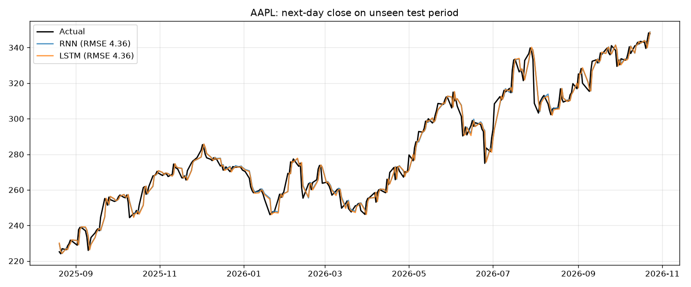

# 📈 Stock Price Prediction: RNN vs LSTM

Predicts the next day's closing price of any Yahoo Finance ticker with two PyTorch models, a **vanilla RNN** and an **LSTM**. Both are compared with a naive baseline, and there is a Streamlit dashboard plus a multi-day forecast.

> Educational project. Not financial advice.

## How it works

1. **Data (`data.py`)**: downloads adjusted daily closes with `yfinance` (cached in `data/`) and splits them **in time order**: 80% train, 10% validation, 10% test.
2. **Inputs**: each sample is the last 60 days written relative to the latest day, `log(price[t-k] / price[t])`. The target is tomorrow's log return. This is scale-free, so the model works at any price level.
   - *Why not feed raw prices?* The first version did, and failed badly. AAPL in the test period traded above every price seen in training, and a model trained on scaled raw prices can't predict beyond that range. RMSE was 23–35 vs 4.4 for the naive guess.
3. **Models (`model.py`)**: `PriceRNN(cell="rnn" | "lstm")`, with 2 recurrent layers, 64 hidden units, dropout, and a linear head. Both use exactly the same architecture, so the comparison is fair.
4. **Training (`train.py`)**: Adam, MSE loss, gradient clipping (the plain RNN needs it), and early stopping on validation loss.
5. **Evaluation**: RMSE, MAE, MAPE, and **direction accuracy** (did it call up/down correctly?) on the unseen test period, compared with **naive: tomorrow = today**.
6. **Forecast (`predict.py`)**: recursive. Each predicted day is fed back in to predict the next.

## Results: AAPL, test period Aug 2025 → Oct 2026 (297 days)

| Model | RMSE | MAE | MAPE | Direction acc. |
|---|---|---|---|---|
| Naive (tomorrow = today) | 4.357 | 3.090 | 1.09% | n/a |
| RNN | 4.359 | 3.096 | 1.10% | 51.9% |
| LSTM | 4.355 | 3.097 | 1.10% | 49.2% |



**How to read this:** the models track the price closely (about 1% error), but so does "tomorrow = today". Direction accuracy is around 50%, like a coin flip. Daily prices are close to a random walk, so a model that only sees past prices can't do much better. Many online tutorials show a "perfect-looking" LSTM chart without this baseline. Comparing against one is the most important skill this project teaches.

**Ideas to explore:** add volume and technical indicators (RSI, moving averages), news sentiment, or predict weekly instead of daily moves, then check whether you beat the baseline.

## Run it

This project uses its own virtual environment because it needs PyTorch.

```bash
python3 -m venv .venv
.venv/bin/pip install -r requirements.txt
```

```bash
.venv/bin/python train.py --ticker AAPL            # ~1 min on CPU
```

```bash
.venv/bin/python predict.py --ticker AAPL --days 10
```

```bash
.venv/bin/streamlit run app.py
```

Any Yahoo Finance symbol works: `MSFT`, `TSLA`, `RELIANCE.NS`, `TCS.NS`, `^NSEI` (Nifty 50). Use `--refresh` to re-download the latest prices, and `--device mps` to train on the Apple GPU (CPU is usually as fast for models this small).

## Project structure

```
data.py      download + cache prices, scale-free sliding windows, time-ordered split
model.py     PriceRNN (RNN / LSTM), price conversion, recursive forecast
train.py     trains both models, early stopping, metrics vs baseline, saves plot
predict.py   N-day forecast CLI
app.py       Streamlit dashboard (train any ticker, test chart, metrics, forecast)
models/      <TICKER>_rnn.pt, <TICKER>_lstm.pt, <TICKER>_meta.json, <TICKER>_test_plot.png
```
