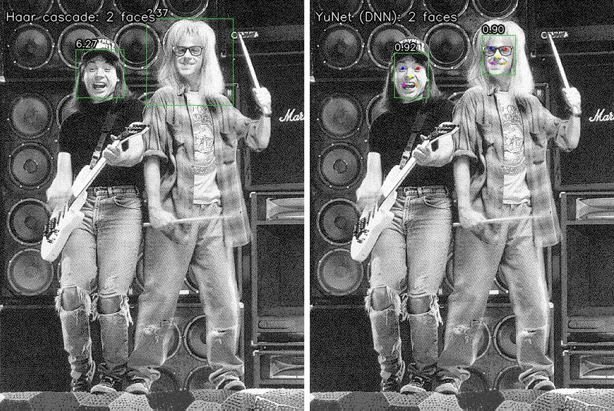
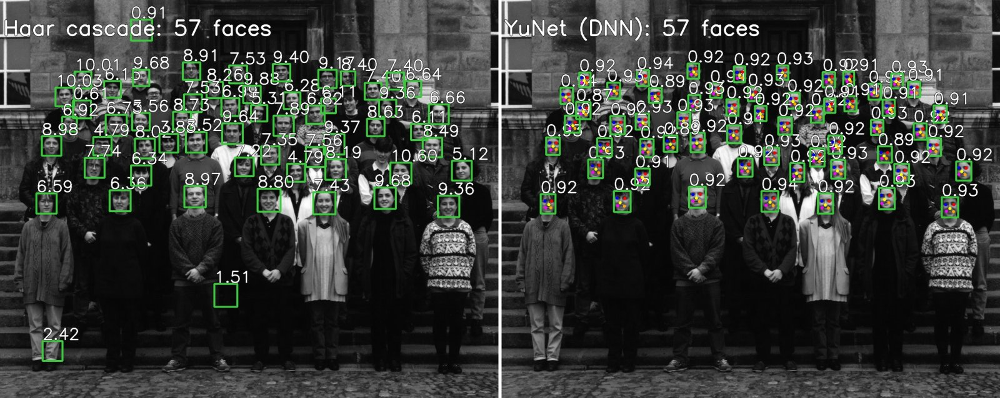

# 🙂 Face Detection: Haar Cascade vs YuNet (DNN)

Detects faces in images, videos and the webcam with two classic OpenCV detectors, and compares them on speed and accuracy. Features: bounding boxes with scores, face count, adjustable thresholds, an optional **blur/anonymise** mode, 5-point facial landmarks (YuNet), a CLI, a benchmark and a Streamlit app.



*Left: Haar finds both people, but its box for the man on the right is about three times too big, so it counts as a false positive. Right: YuNet draws tight boxes, with landmarks for the eyes, nose and mouth corners.*

## How the two detectors work

**Haar cascade (Viola-Jones, 2001)** uses `haarcascade_frontalface_default.xml`, which ships with OpenCV.
- It slides a window over an image pyramid. At each position it runs a *cascade* of stages, and each stage tests a few rectangle-contrast features (for example, "eyes are darker than cheeks").
- Most windows fail the first stages, which makes it fast on old CPUs.
- It only knows upright, frontal faces, and it has no real confidence score. We show the final stage's weight, which is not a probability.
- Tuning: `scaleFactor` is the pyramid step (smaller is slower but finds more sizes). `minNeighbors` is how many overlapping hits a face needs (higher means fewer false positives, but more misses).

**YuNet (2023)** uses `cv2.FaceDetectorYN` with `face_detection_yunet_2023mar.onnx` from the OpenCV model zoo.
- It is a tiny CNN, about 75k parameters, trained on WIDER Face.
- For each face it predicts a box, a confidence in [0, 1] and 5 landmarks, then removes duplicates with non-maximum suppression.
- It handles pose, lighting and scale much better than Haar. Tuning: a confidence threshold (default 0.6).

## Results

`benchmark.py` runs both detectors on the 8 bundled images. The machine was an Apple Silicon Mac with OpenCV 4.14 on **1 CPU thread**. Each time is the median of 20 runs after a warm-up.

| Image | Size | True faces | Haar found | Haar TP/FP | Haar ms | YuNet found | YuNet TP/FP | YuNet ms |
|---|---|---|---|---|---|---|---|---|
| addams-family.png | 864x890 | 7 | 7 | 7/0 | 206.2 | 7 | 7/0 | 35.3 |
| astronaut.png | 512x512 | 1 | 1 | 1/0 | 42.8 | 1 | 1/0 | 11.6 |
| class57.png | 1280x1024 | 56 | 57 | 54/3 | 410.4 | 57 | 56/0 | 64.0 |
| karen-and-rob.png | 336x484 | 2 | 2 | 2/0 | 37.0 | 2 | 2/0 | 7.7 |
| lena.jpg | 512x512 | 1 | 1 | 1/0 | 47.8 | 1 | 1/0 | 11.6 |
| messi5.jpg | 548x342 | n/a | 2 | n/a | 40.1 | 1 | n/a | 8.7 |
| rehg-thanksgiving-1994.png | 580x396 | 7 | 7 | 7/0 | 50.1 | 7 | 7/0 | 11.1 |
| waynesworld2.png | 443x599 | 2 | 2 | 1/1 | 73.4 | 2 | 2/0 | 11.9 |

| Detector | Labelled faces | TP | FP | FN | Precision | Recall | Mean time / image (1 thread) | Mean time (all cores) |
|---|---|---|---|---|---|---|---|---|
| Haar cascade | 76 | 73 | 4 | 3 | 94.8% | 96.1% | 113.5 ms | 29.0 ms |
| YuNet (DNN) | 76 | 76 | 0 | 0 | 100.0% | 100.0% | 20.2 ms | 10.4 ms |

**How to read this honestly:**
- **YuNet was about 5x faster than Haar** on a single thread, and about 3x faster on all cores. This surprises people who expect "deep learning" to be slower. Haar's cost grows with image size and the number of pyramid levels, while YuNet is a very small network.
- **Haar's errors are typical:** a box on the stone wall, two boxes on the stairs and trousers in the class photo, and a box three times too big on Wayne's World. It missed 2 faces in the class photo. The oversized Wayne's World box also counts as a miss, which makes 3. YuNet's single extra box in `class57.png` sits on a bowed head whose face is hidden. That box is marked "ignore", so it counts neither way.
- **The labels are not independent of YuNet.** `samples/labels.json` was made by drawing both detectors' boxes, checking each one by eye, removing non-faces, and looking for faces both had missed (none found). The kept boxes are YuNet's, so YuNet's 100% means "every face a human could see, YuNet found, and it found nothing else". It does **not** mean YuNet is perfect. Matching uses a lenient IoU of at least 0.3 so that Haar's square boxes are not penalised for their shape.
- **This is a tiny sample:** 7 labelled images, 76 faces, mostly grayscale, mostly frontal faces from the CMU/MIT test set. It shows the trend; it is not a WIDER Face / FDDB evaluation. `messi5.jpg` is not labelled, because its background crowd has dozens of tiny faces nobody can label reliably. At threshold 0.5, YuNet starts picking up some of those crowd faces.



## Run it

This project has its own virtual environment.

```bash
python3 -m venv .venv
```

```bash
.venv/bin/pip install -r requirements.txt
```

Download the YuNet weights (checked against opencv_zoo's published SHA-256 and size) and the sample images:

```bash
.venv/bin/python download_models.py
```

```bash
.venv/bin/python download_samples.py
```

Detect faces in an image (saves an annotated copy):

```bash
.venv/bin/python detect.py --image samples/addams-family.png --detector dnn --out outputs/addams.jpg
```

Use Haar with custom settings, and blur the faces:

```bash
.venv/bin/python detect.py --image samples/class57.png --detector haar --min-neighbors 8 --blur --out outputs/class_blur.jpg
```

Process a video file (add `--show` to watch it live):

```bash
.venv/bin/python detect.py --video path/to/clip.mp4 --detector dnn --blur --out outputs/clip_blurred.mp4
```

Use the webcam (opens a window with live FPS; press `q` to quit):

```bash
.venv/bin/python detect.py --webcam --detector dnn
```

Run the benchmark (add `--threads 0` to use all cores):

```bash
.venv/bin/python benchmark.py
```

Open the Streamlit app. It shows Haar and YuNet side by side, with sliders, a blur toggle, landmarks, camera snapshots and annotated-image downloads:

```bash
.venv/bin/streamlit run app.py
```

Other options: `--threshold` (YuNet confidence), `--scale-factor` and `--min-neighbors` (Haar), and `--camera N` (webcam index).

## Project structure

```
detectors.py          HaarDetector + YuNetDetector, common detect(image) -> list[Face]
draw.py               boxes, scores, landmarks, face count, blur/pixelate anonymiser
detect.py             CLI: --image / --video / --webcam, --blur, --out
benchmark.py          speed + precision/recall against samples/labels.json
app.py                Streamlit side-by-side comparison
download_models.py    fetches + verifies YuNet ONNX weights into models/
download_samples.py   fetches sample images into samples/
samples/              test images + labels.json (hand-verified face boxes)
docs/                 comparison images used in this README
models/               downloaded weights (git-ignored)
outputs/              annotated results (git-ignored)
```

## Model and image sources

- YuNet weights: [opencv/opencv_zoo `models/face_detection_yunet`](https://github.com/opencv/opencv_zoo/tree/main/models/face_detection_yunet), MIT licence.
  - `face_detection_yunet_2023mar.onnx` is the one used.
  - `face_detection_yunet_2026may.onnx` (the same network with dynamic input shape) is downloaded as a fallback for OpenCV 5.
- Haar cascade: comes with `opencv-python` (`cv2.data.haarcascades`).
- Images:
  - `astronaut.png` comes from scikit-image (NASA, public domain).
  - `lena.jpg` and `messi5.jpg` come from [opencv/opencv `samples/data`](https://github.com/opencv/opencv/tree/4.x/samples/data).
  - The multi-face images come from [opencv/opencv_extra `testdata/cv/cascadeandhog/images`](https://github.com/opencv/opencv_extra/tree/4.x/testdata/cv/cascadeandhog/images). They are part of the classic CMU/MIT frontal-face test set and are meant for research and demos; check their terms before reusing them elsewhere.

## Limitations

- **Webcam mode has not been tested.** It was written for a machine with a camera, and the development environment had none. Video-file mode *was* tested on a synthetic clip, including writing the output file and blurring. On macOS, the first webcam run asks for camera permission for your terminal.
- **OpenCV is pinned below 5.** OpenCV 5.0 moved `CascadeClassifier` out of the main `opencv-python` package, so the Haar detector would fail there.
- Haar finds only upright frontal faces. It produces false positives on textures (walls, stairs, fabric), and its scores are not probabilities, so they cannot be compared with YuNet's.
- YuNet is trained for faces of about 10 to 300 px. Very large close-up faces may need the image scaled down first.
- Blur mode pixelates and blurs only the faces that were *detected*. A missed face stays visible, so do not rely on it for real anonymisation without checking the result.
- The accuracy numbers come from a small, hand-labelled sample with labels derived from YuNet (see above). Treat them as a demonstration, not a published benchmark.
